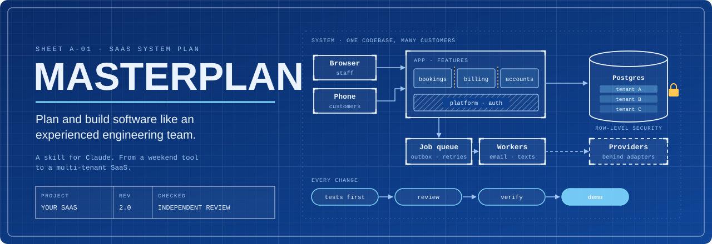
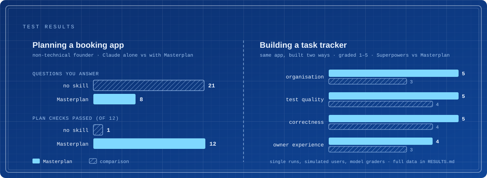

<p align="center">
  
</p>

Masterplan is a skill for Claude that plans and builds software the way a good engineering team would. You describe the app. It asks a few questions in plain English, writes a plan you can check, then builds it one milestone at a time. You see each milestone running before it moves on.

I made it because AI coding tools are quick to write code and slow to ask who it's for or what it'll cost to run. Masterplan does that part first.

## How it works

|  |  |  |  |  |
|:--|:--|:--|:--|:--|
| **Ask** | **Plan** | **Review** | **Build** | **Demo** |
| A few questions, each with a suggested answer. Reply "yes" to take them all. | One setup with the stack, hosting and monthly cost, saved in your repo. | Fresh reviewers try to break the plan before any code exists. | Starts when you say go. Tests come first and every task gets reviewed. | You try each milestone yourself before the next one starts. |

## Who it's for

Founders and product people who don't code. Developers starting a new app or SaaS who want it planned and tested properly. Small teams who want a repo that any developer or coding agent can pick up later.

It's probably not what you want for a quick change to an existing codebase. If you're an experienced engineer with the architecture already worked out, [Superpowers](https://github.com/obra/superpowers) is faster. If you're still deciding whether the idea is worth building, try [grill-me](https://github.com/mattpocock/skills) first.

## Common questions

**Do I need to know how to code?**
No. Every question comes with a recommended answer, and "I'm not sure, what do you recommend?" is always an option. You won't be asked to read code.

**Small app or big SaaS?**
Both. At the start it rates the project on risk and on size, and the amount of process follows from that. A personal tracker gets a handful of questions and four short docs. A SaaS with thousands of customers also gets security and operations docs, load tests and gradual rollouts.

**What ends up in my repo?**
Working code with tests, organised by feature, plus a few Markdown files: `AGENTS.md`, requirements, decision records, a roadmap, a status file and a README. Any developer or coding agent can carry on from there, with or without Masterplan.

**Does it choose the tech stack?**
If you want it to. It recommends one setup based on current prices and docs, explains it in plain words, lists the accounts you'll need to create, and tells you when your own idea is likely to cost you later.

**How long does it take?**
Planning takes 15 to 40 minutes. Building is slower than letting an agent write code straight away, because every task is reviewed and every milestone is demoed. That's where the bugs get caught.

**Can I stop and come back later?**
Yes. Progress is saved in the repo, so a new session picks up where the last one stopped.

**Will it push or deploy anything without asking?**
No. It works on a branch and asks before it pushes, deploys, deletes data or spends money.

**Where do the ideas come from?**
The question style comes from Matt Pocock's grill-me and the build loop from Jesse Vincent's Superpowers, both rewritten to work together. [CREDITS.md](CREDITS.md) has the details.

## Test results



Each test ran once with a simulated user, and a separate model did the grading. More runs with real people would make these numbers firmer. The full results and test scenarios are in [RESULTS.md](RESULTS.md) and [`evals/`](evals/).

## Install

Tell Claude Code:

> Install the Masterplan skill from https://github.com/Refuzal/Masterplan

It clones the repo and runs `install.sh`. [INSTALL.md](INSTALL.md) has the steps if you'd rather do it by hand. In the Claude apps, download `masterplan.skill` from Releases and add it in the app's skill settings.

The helper scripts need Python 3.8 or newer and git.

## Usage

```
/masterplan I want an app where dog groomers take bookings and send reminders
/masterplan build                    continue building the approved plan
/masterplan fix Tasks vanish when I filter by owner
/masterplan change We now need it to work offline
/masterplan review                   check the code and docs for drift
```

You can also just describe what you want to build and it'll start on its own.

## License

MIT. See [LICENSE](LICENSE).
