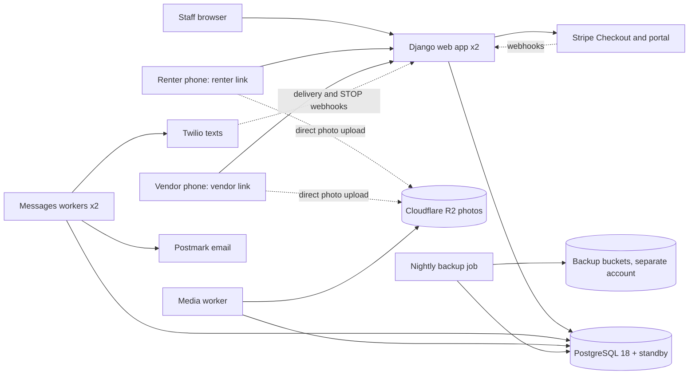

# Architecture

> Purpose: the current, approved structure of the system. Binding for all changes. Update in the same change that alters it. Owner: Ravi (backend co-founder, lead engineer), with human approval for material changes.

## Summary
One Django application (a modular monolith) serves three audiences from the same code: staff who sign in, renters who use a renter link, and vendors who use a vendor link. Pages are rendered on the server, with htmx for partial updates. All data lives in one PostgreSQL database shared by every company, where row-level security keeps each company's rows private. Background workers send email and texts, process photos and run scheduled tasks from a queue stored in the same database. Everything runs on Render in the Ohio region; photos live in Cloudflare R2. This shape fits a two-person team: one thing to deploy, watch and reason about, with room for 2,000 companies (NFR-6). Approved by the product owner on 2026-10-19 and corrected after the review panel the same day (Review log).

## Components and boundaries
Each component is a Django app. Layers, from top to bottom: `metrics` → `maintenance` → `properties` → (`billing`, `links`, `notifications`, `media`) → `accounts` → `core`. A layer may import only layers below it; the four apps in the same layer may not import each other. Higher layers call lower ones; lower layers never reach up (for example, `properties` calls `billing.set_quantity()` when buildings change, and `maintenance` keeps the links between requests and `media` photos).

| Component | Responsibility | Owns data | May call | Must not |
|---|---|---|---|---|
| `core` | Company context, lookups and row-level security helpers, `CompanyOwnedModel`, job wrapper, settings, health check | None | Django, PostgreSQL | Import any other app |
| `accounts` | Companies, staff users, roles, invitations, sign-in (allauth), two-step verification, permission checks | Companies, users, memberships, invitations | `core` | Contain maintenance logic |
| `billing` | Stripe customer and subscription, subscription quantity, webhooks, account standing | Subscriptions, billing events | `accounts`, `core`, Stripe | Store card data; read buildings |
| `links` | Renter and vendor link tokens (subject kind and ID only), link sessions, link reissue | Link tokens | `accounts`, `core` | Store, log or display raw tokens after sending |
| `notifications` | Email and text sending, templates, opt-outs, sender numbers and their verification | Messages, sender numbers, opt-outs | `accounts`, `core`, Postmark, Twilio | Send from a web request (jobs only) |
| `media` | Upload links, photo processing, viewing links | Photos (no reference to requests) | `accounts`, `core`, R2 | Serve an unprocessed upload |
| `properties` | Buildings, units, renters, spreadsheet import, sending renter links | Buildings, units, renters, imports | Layers below | Call an external service directly |
| `maintenance` | Maintenance requests, work orders, vendors, status rules, activity history, request queue, renter and vendor pages, request and work order photos | Requests, work orders, vendors, activity events, photo links | Layers below | Call an external service directly |
| `metrics` | Founders-only pilot metrics (FR-23) | None (reads only) | Layers below; the read-only metrics database role | Be reachable by company staff |

Enforcement: import-linter contracts in CI (a layers contract plus an independence contract for the middle layer); forbidden contracts so only the owning app imports `twilio`, the Postmark client, `stripe` or `boto3`; a test that fails when a model has `company_id` but does not inherit `CompanyOwnedModel`. M1 runs the contracts against the real app skeleton before features are added.

## Data model
Main entities (primary keys are UUID version 7 from PostgreSQL's `uuidv7()`):
- **Company** — name, emergency line, on-call contact (name, phone, email), time zone, status.
- **User** (staff) — email login; **Membership** links a user to a company with one role: company admin, property manager or maintenance coordinator. [Assumption] One company per staff member in version 1; the schema allows more (risks.md A-9).
- **Invitation** — company, email, role, token hash, expiry (7 days).
- **Building** — company, name, address, kind (multi-unit or single-family), archived time. Active buildings set the subscription quantity.
- **Unit** — company, building, label. **Renter** — company, unit, name, phone, email, archived time.
- **LinkToken** — company, kind (renter or vendor), subject ID, token hash, expiry, revoked time, last used time.
- **Vendor** — company, name, trade, phone, email.
- **MaintenanceRequest** — company, unit, renter, number (sequence per company), description, permission to enter, urgent flag, source (renter link or staff), status.
- **WorkOrder** — company, maintenance request, vendor, instructions, priority, status, scheduled time.
- **Photo** (`media`) — company, storage key, processed time; **RequestPhoto** and **WorkOrderPhoto** (`maintenance`) link photos to their request or work order.
- **ActivityEvent** — company, request, work order, actor kind (staff, renter, vendor, system), actor, action, details, time. Append-only: the app role may insert and read, never update or delete.
- **Message**, **SenderNumber**, **OptOut** (`notifications`); **Subscription**, **BillingEvent** (`billing`).
- **Founder accounts** are Django superusers with two-step verification and no company membership; only they can open the Django admin and `metrics` (FR-23). `metrics` reads existing tables through the metrics role and stores nothing of its own.

Statuses (rules live in `maintenance.statuses` and nowhere else):
- Maintenance request: new → work order sent → scheduled → completed → closed; or cancelled. A declined work order returns the request to "new" and marks it for reassignment.
- Work order: sent → accepted or declined → scheduled → done → closed; or cancelled.

Company isolation (ADR-0003):
- Every company-owned table has a non-null, indexed `company_id` and row-level security with the standard policy `company_id = current_setting('app.company_id', true)::uuid` for reads and writes; the Company table matches on `id`.
- Lookup policies allow the few reads needed before the company is known, each keyed on one exact value set by `core.tenancy.lookup()`: link token hash, invitation token hash, the signed-in user's memberships, renter phone or email (link re-issue), Stripe customer ID, and Twilio or Postmark message and number IDs.
- Staff sign-in tables (users, email addresses, two-step devices, sessions) are global; staff lists are always reached through company-scoped memberships.
- Procrastinate's tables are not company-scoped, so job payloads hold IDs only, including `company_id`.

## Key flows
1. **Renter submits a request.** The renter opens the renter link → `core.tenancy.lookup()` finds the token hash and company, `links` opens a link session and redirects to a clean address → the page shows the company's emergency line → photos upload straight to R2 through upload links from `media` → on submit, one transaction saves the request and its activity event and defers jobs: process the photos (`media` queue), notify staff, and, if urgent, text the on-call contact (`messages` queue) → the renter sees a confirmation with the request number and the emergency line.
2. **Staff dispatch a vendor.** Staff open the request queue (urgent first) → create a work order with vendor, instructions and priority → one transaction saves the work order, creates the vendor link token and defers jobs: send the vendor link, update the renter.
3. **Vendor updates the job.** The vendor opens the vendor link → accepts and schedules, adds notes and photos, or marks it done → each change saves an activity event and defers notifications to staff and the renter.
4. **Company subscribes.** A company admin starts Stripe Checkout (with a trial for pilot companies); creating the Checkout or customer-portal session is the one Stripe call made inside a web request, because the admin is waiting → Stripe webhooks, verified and processed once in a job, update the subscription → adding or archiving a building calls `billing.set_quantity()`, which updates Stripe in a job.

## Security model
- **Sign-in:** staff use django-allauth with email and password (Argon2 hashing) or a passkey; two-step verification is required for company admins and available to all staff; sign-in attempts are rate-limited; invitations are single-use and expire after 7 days (ADR-0004).
- **Permissions:** roles are checked on the server in `accounts.permissions`, called by every staff view; company admins alone manage staff, billing and settings. Account standing (FR-7) is checked through `billing`. Templates may hide buttons but never enforce permissions.
- **Company isolation:** every request runs in a transaction and `core.tenancy` sets the company context for that transaction only; row-level security applies to every company table; the app role neither owns tables nor has `BYPASSRLS`; owner credentials exist only in the migration step and the backup job; pre-company reads use only the listed lookup policies; isolation and schema tests run on every pull request (ADR-0003).
- **Renter and vendor links:** 256-bit random tokens stored as SHA-256 hashes, scoped to one renter or one work order, revocable; renter links lapse after 180 days unused; vendor links expire 30 days after the work order closes; re-issue is rate-limited per contact and per company, and the old link keeps working until the new one is opened; tokens are exchanged for a session cookie and removed from the address bar; `Referrer-Policy: no-referrer`; tokens scrubbed from logs and Sentry (ADR-0004).
- **Founder support access:** the Django admin requires a founder account with two-step verification and works inside one chosen company at a time; the cross-company `metrics` app uses the read-only metrics role; every support access is logged.
- **Secrets:** production secrets live only in Render environment groups, readable by the two founders; the media worker has no email, text or Stripe keys; only the backup job has the backup-bucket key; local and preview environments use test-mode keys; nothing secret is committed (`.env` is ignored; `.env.example` lists names only).
- **Top threats and mitigations:**
  - One company sees another's data through a coding mistake → row-level security, listed lookups only, isolation tests on every pull request.
  - A forwarded or leaked link is misused → narrow scope, expiry, revocation, rate limits, minimal renter details on vendor pages (risks.md A-8).
  - Someone floods a renter with link re-issues → per-contact and per-company limits; old links stay valid until replaced; staff warning.
  - A staff account is taken over → two-step verification for admins, rate limits, sign-in audit log, Argon2.
  - A malicious upload → size and type limits, pixel and time limits, processing on a worker without messaging or payment keys, private bucket, originals deleted.
  - The product is used to send spam → only staff-entered contacts receive messages, no free-text bulk sending, per-company daily caps.
  - An AI agent damages production or loosens its own rules → agents never hold production credentials; backups live in a separate account; CODEOWNERS requires Ravi's review for guardrail files (standards.md).

## Environments and deployment
| Environment | Purpose | Data | Who can deploy |
|---|---|---|---|
| Local | Development | Fake or seed data only; local PostgreSQL 18 in Docker | Developers and agents |
| Preview (one per pull request, on Render) | Review each change in a real environment | Seed data from `scripts/seed` only; email to Postmark's test server, texts to Twilio test credentials; Stripe test mode; smallest sizes; expires after 3 idle days | Created by Render from `render.yaml`; destroyed when the pull request closes |
| Production (Render, Ohio) | Real users | Real data; agents have no access | Automatic from `main` after CI passes and a human approves the pull request |

Infrastructure is described in `render.yaml`. Database migrations run as a pre-deploy step with the owner role and must stay compatible with the previous release (add first, remove later), and job payloads stay compatible for one release, so old and new code can run side by side and a code rollback works. Render switches traffic only after the new release passes the health check, which queries the database inside a company context.

## Operations
- **Monitoring and alerts:** Sentry for errors and slow pages, with personal data and tokens scrubbed; Better Stack checks the health endpoint every minute from several locations and runs a public status page; each queue sends a heartbeat every minute, and a check reports the age of the oldest unsent urgent alert. A phone call goes to Ravi (the product owner is backup by chat and email) only when the site is down for 5 minutes, the `messages` heartbeat stops for 5 minutes, or an urgent alert has waited 3 minutes. Everything else (error spikes, failed jobs, rejected text verifications, the media queue) goes to email and chat for business hours.
- **Backups:** Render point-in-time recovery for 7 days. A nightly Render cron job, running as the owner role, writes an encrypted logical backup and copies new photos to buckets in a separate Cloudflare account using an upload-only key; backups are kept 30 days, and photos deleted from the main bucket stay in the backup for 30 days.
- **Restore runbook** (drill before the pilot and every quarter, timed against NFR-3; last tested: not yet, roadmap M1):
  1. Restore the database with Render point-in-time recovery to a new instance (or load the latest nightly backup into one).
  2. Recreate or check the app and metrics roles, their grants and the row-level security policies (a script in `scripts/`), then run the schema test against the restored database.
  3. Point the web service, workers and backup job at the new database through the Render environment group, and redeploy.
  4. Run the smoke tests and the isolation tests against production in read-only mode; post an update on the status page.
- **Releases and rollback:** a bad release is rolled back to the previous deploy in Render's dashboard.
- **Incidents:** post on the status page; fix or roll back; tell affected companies promptly about any data incident so they can meet their own notification duties; write a short review afterwards and turn its lessons into tests or checks.

## Cost
Prices checked 2026-10-19 (sources in the ADRs). Monthly, in US dollars.

| Item | Pilot launch (20 companies) | About 200 companies |
|---|---|---|
| Render: Pro workspace, 2 web, 2 small messages workers, 1–2 media workers, backup job, previews | $125–140 | $175–210 |
| Render Postgres, primary and standby, with storage | $90 | $230 |
| Cloudflare R2 photos and backups | $0–2 | about $20 |
| Postmark email | $15 | $70–90 |
| Twilio numbers ($2.15 each: one per company plus our staff-alert number) | $45 | $432 |
| Twilio texts (about $0.0125 per US segment) | $60–190 | $625–1,875 |
| Sentry Team | $29 | $29–89 |
| Better Stack phone alerts (one responder seat) | about $34 | about $34 |
| GitHub Team (2 users) and domain | $10 | $10 |
| **Total** | **about $410–560** | **about $1,650–3,000** |

Assumptions: 100–500 units per company; 0.2–0.4 maintenance requests per unit per month; 4–6 text segments per request (risks.md A-3). The biggest cost driver is texting: about two-thirds of the cost at 200 companies (risks.md R-4). The launch range tops the $500 budget only if texting is heavy; per-company daily caps and the monthly review keep it near budget. Cliffs: Render Pro includes 25 GB of bandwidth, then $0.15/GB; Postmark tiers start at 10,000 emails; Sentry Team includes 50,000 errors; high availability doubles every database resize. Canadian text rates are not yet checked (roadmap M0). Stripe fees scale with revenue and are not counted here. Billing alerts are set on every paid service (roadmap M0).

## Scaling path
At about 2,000 companies (10× the year-one estimate), expect to: resize PostgreSQL to 4 CPU / 16 GB or more and add a read replica for metrics and reports; let web instances autoscale (2–6) and add workers per queue; watch the 100-connection limit first (each web instance pools at most 10); partition the activity and message tables by time if they pass about 100 million rows; consider a dedicated queue broker if jobs pass about 50 per second. Do none of this before its trigger: sustained database CPU above 70%, connections above 70% of the limit, staff pages missing NFR-1, or queue delay missing NFR-9.

## Binding decisions
| ADR | Decision | Status |
|---|---|---|
| [ADR-0001](decisions/0001-python-django-modular-monolith.md) | Python and Django modular monolith with server-rendered pages | Accepted |
| [ADR-0002](decisions/0002-postgresql-managed-on-render.md) | PostgreSQL 18 on Render with standby and point-in-time recovery | Accepted |
| [ADR-0003](decisions/0003-company-isolation-shared-database-rls.md) | Shared database, company IDs and row-level security with listed lookups | Accepted |
| [ADR-0004](decisions/0004-staff-sign-in-and-link-access.md) | Staff sign-in with django-allauth; secure renter and vendor links | Accepted |
| [ADR-0005](decisions/0005-background-jobs-procrastinate.md) | Background jobs with Procrastinate, two queues | Accepted |
| [ADR-0006](decisions/0006-hosting-render.md) | Hosting on Render, Ohio, with preview environments | Accepted |
| [ADR-0007](decisions/0007-photo-storage-cloudflare-r2.md) | Photo storage on Cloudflare R2 | Accepted |
| [ADR-0008](decisions/0008-email-postmark-texts-twilio.md) | Postmark email; Twilio texts with a number per company and one for staff alerts | Accepted |
| [ADR-0009](decisions/0009-billing-stripe.md) | Stripe Billing | Accepted |

## Review log
Review panel on 2026-10-19: three independent reviewers (technology and architecture; infrastructure, operations and cost; security and critical review, the last on a different model). Material findings and resolutions:

| Date | Finding (source) | Resolution |
|---|---|---|
| 2026-10-19 | Backups, metrics, link lookups, invitations, sign-in and webhooks all need reads across companies, but the plan banned any bypass and forced row-level security on the owner (reviewers 1 and 3; reviewer 1 rated it a blocker) | Changed: owner role used only by migrations and the backup job; listed lookup policies; metrics role via `SELECT` policies; no `BYPASSRLS` anywhere; M0 spike on Render (ADR-0003) |
| 2026-10-19 | An app named `platform` shadows Python's standard `platform` module (reviewer 1) | Changed: renamed to `core` |
| 2026-10-19 | Layer rules contradicted the data model: photos pointed up to requests, billing read buildings (reviewer 1) | Changed: photo links live in `maintenance`; `properties` calls `billing.set_quantity()` |
| 2026-10-19 | Transactional job deferral with the Django ORM and connection pooling were unproven (reviewers 1 and 2) | Changed: M0 spike with an `on_commit` fallback; Django's built-in pool, no external pooler (ADR-0002, ADR-0005) |
| 2026-10-19 | The per-transaction company context needs every query inside a transaction (reviewers 1 and 3) | Changed: `ATOMIC_REQUESTS`; setting a context outside a transaction raises an error; one helper for jobs, commands and tests |
| 2026-10-19 | One worker and a 15-minute heartbeat could silence urgent alerts; urgent texts depended on each company's verification (all three) | Changed: two `messages` workers; page at 3 minutes of urgent-alert delay or 5 minutes without heartbeat; staff alerts from our own verified number from day one (ADR-0008) |
| 2026-10-19 | Photos had no backup; the restore steps for roles and policies were missing (reviewer 2) | Changed: nightly photo copy with 30-day retention; restore runbook above |
| 2026-10-19 | Renter link re-issue could be abused to lock renters out or run up text costs; links never expired (reviewer 3) | Changed: per-contact and per-company limits, old link valid until replaced, 180-day inactivity expiry (ADR-0004) |
| 2026-10-19 | Untrusted image decoding ran on the worker holding all credentials (reviewer 3) | Changed: separate `media` worker without messaging or payment keys; pixel and time limits |
| 2026-10-19 | The product owner could approve changes to agent rules without engineering review (reviewer 3) | Changed: CODEOWNERS on guardrail files now, not later (standards.md) |
| 2026-10-19 | Python 3.14 and Django 6.1 are the newest combination; suggested Django 5.2 LTS and Python 3.13 (reviewers 1 and 3) | Partly accepted: a Python 3.13 fallback rule in M0; Django 6.1 kept because 5.2's mainstream support ended in December 2025 and 6.2 LTS is one step away (ADR-0001) |
| 2026-10-19 | 99.9% availability cannot be guaranteed on one Render region (reviewers 2 and 3) | Rejected as a change: it stays an internal objective, never promised to customers (NFR-2); emergencies never depend on the app (risks.md R-6, R-8) |
| 2026-10-19 | Cost per company grows with units and texts while price grows with buildings (reviewer 2) | Recorded for the product owner before billing (risks.md Q-6, R-4) |
| 2026-10-19 | 18 weeks of milestones leave no buffer before the pilot (reviewer 3) | Escalated to the product owner: what to cut first if late (risks.md R-11) |
| 2026-10-19 | Mutation testing on every pull request, Semgrep and per-company feature flags are heavy for two people (reviewers 1 and 3) | Partly accepted: mutation testing weekly only; feature flags removed until a risky change needs one; Semgrep and import contracts kept because they are cheap, deterministic checks on AI-written code |
| 2026-10-19 | Cold-start test (a fresh agent with only the repository) answered all eight questions correctly; it found who authorizes building, founder accounts and the Python fallback unclear | Changed: AGENTS.md and the data model now state them |
