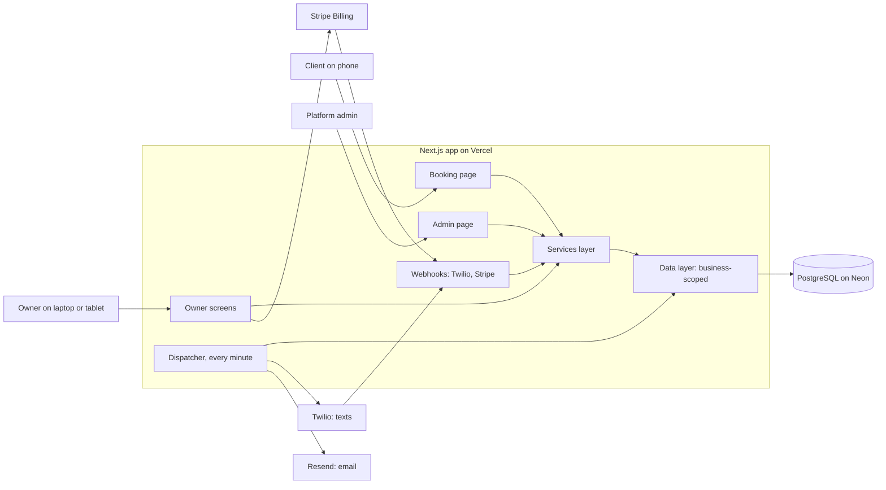

# Architecture

> Purpose: the current, approved structure of the system. Binding for all changes. Update in the same change that alters it. Owner: lead engineer (currently the planning agent), with the founder's approval for material changes.

## Summary
One TypeScript web app (Next.js) deployed on Vercel serves three audiences: clients on the public booking page, owners on the calendar and records screens (one calendar per groomer, ADR-0011), and the platform admin. All data lives in one PostgreSQL database on Neon, shared by all businesses and scoped by business on every row. Every text and email is a row in a message outbox that a per-minute cron job dispatches through Twilio (texts) or Resend (email). Stripe handles subscriptions on its own hosted pages. This is the simplest shape that meets version 1: one deployable, one database, managed services for everything commodity, and no infrastructure for the owner to run.

## Components and boundaries
| Component | Responsibility | Owns data | May call | Must not |
|---|---|---|---|---|
| `src/app/(public)/` booking page | Show a business, open times, take booking requests | — | Services layer | Show any stored client or pet details; import the database client |
| `src/app/(owner)/` owner screens | Calendars per groomer, requests, clients and pets, groomers and settings, billing links | — | Services layer | Import the database client; trust a business ID from the browser |
| `src/app/(admin)/` admin page | Businesses, subscription and texting status, text usage | — | Services layer (admin functions only) | Load client or pet data |
| `src/app/api/webhooks/` | Twilio inbound texts and status callbacks; Stripe events | — | Services layer | Act on a request whose signature fails |
| `src/app/api/cron/` | Dispatcher entry point (ADR-0008) | — | Services layer | Run without the cron secret |
| `src/server/services/` | Business rules: availability, booking requests, reminders, consent, billing state | — | Data layer, messaging and billing adapters | Talk to the database directly |
| `src/server/data/` | The only database access; every function requires a business context | All tables | Database client | Accept a business ID from user input |
| `src/server/messaging/` | `TextMessenger` and `EmailSender` interfaces, Twilio and Resend implementations, fakes, message builder | — | Twilio, Resend | Be called outside the dispatcher (except the fakes in tests) |
| `src/server/billing/` | Stripe Checkout, customer portal links, webhook parsing | — | Stripe | Store card data |

Enforced automatically: an import-boundary lint rule (eslint-plugin-boundaries) blocks imports that break the "Must not" column, including any import of the database client outside `src/server/data/`; cross-business isolation tests run in CI (ADR-0005).

## Data model
Every business-owned table has a non-null `business_id`, and foreign keys between them include it (ADR-0005). Times are stored in UTC; each business has an IANA time zone used for display, availability and the sending window.

| Entity | Key fields | Notes |
|---|---|---|
| business | name, slug, time zone, address, phone, email, booking rules, subscription status, Stripe IDs, texting status, texting number | The tenant |
| groomer | name, display order, active | A calendar; not a sign-in in version 1 (ADR-0011) |
| user, session, account, verification, two_factor | Managed by Better Auth | Platform admin flag on user |
| membership | user, business, role (`owner`) | Staff sign-ins later (FR-13) |
| service | name, typical minutes, price | Price shown only; nothing is charged |
| working_hours, time_off | groomer; weekday and times; blocked periods | Per groomer; drive open times |
| client | name, mobile number (E.164), optional email, text consent status | Unique per business by mobile number |
| consent_event | phone number, client if known, opt-in or opt-out, source, consent wording version, time | Per business and phone number; the latest event is authoritative at send time; kept as evidence (requirements.md › Data) |
| pet | client, name, breed, size, notes | |
| appointment | client, pet, service, groomer, start, end, status (`requested`, `booked`, `declined`, `expired`, `cancelled`, `completed`, `no_show`), client confirmation | Booking requests are appointments in `requested` |
| message | channel, direction, kind, recipient, body, send at, status (`scheduled`, `sending`, `sent`, `delivered`, `failed`, `cancelled`, `stuck`), provider ID, segments, cost | The outbox and the message log |
| texting_registration | business details for carriers (EIN optional), contact person, status, rejection reason | Never holds Social Security numbers; every read by the admin is written to audit_event |
| audit_event | actor, action, target, time | Sign-ins, admin actions, settings changes |

## Key flows
1. **Booking request.** The client opens `/b/<slug>`, picks a service, a groomer or "anyone available", and an open time, and submits (BotID check, rate limit, validation). The server re-checks that groomer's availability (or assigns the first free groomer), creates or matches the client and pet, records consent, creates an appointment in `requested`, and emails the owner. Accepting it moves it to `booked` and schedules a confirmation and a reminder in the outbox; declining or expiry schedules a notice.
2. **Reminder.** The dispatcher claims due messages, re-checks appointment status, consent, business status, texting approval and the sending window, sends through Twilio (or Resend before texting approval) with a status callback, and records the result. Stuck sends are reconciled by the status callback or flagged, never resent (ADR-0008).
3. **Client reply.** Twilio posts the inbound text; the webhook checks the signature, finds the business by the receiving number and the client by the sender's number (at most one client per business has a given number), then: C confirms the client's next booked appointment, X cancels it, frees the time and notifies the owner; STOP and other opt-out words record an opt-out for that business and number even if the number is not a client (Twilio's opt-out handling is a second layer); HELP gets the business's name and phone; anything else is stored as plain text on the client record and emailed to the owner as plain text.
4. **Subscription.** The owner starts Stripe Checkout from settings; Stripe webhooks set the subscription status; a failed payment after Stripe's retries pauses the business (FR-1).
5. **Texting setup.** The owner fills in the texting form; the admin submits it in Twilio's console, links the toll-free number, and records approval or rejection (ADR-0007).

## Security model
- Sign-in: Better Auth, email and password with verification and reset, rate-limited; secure http-only session cookies; two-step sign-in required for the platform admin (ADR-0006).
- Permissions: two roles in version 1, business `owner` and platform admin; groomers are calendars, not users (ADR-0011); every check runs on the server in the services layer.
- Tenant isolation: business ID on every business-owned row; one data layer; lint rule; cross-business tests block merges (ADR-0005).
- Public surfaces: the booking form (BotID Basic, rate limits per IP and per mobile number, schema validation, US mobile numbers only, and the same response whether or not a number is already a client); webhooks verify Twilio and Stripe signatures; the cron endpoint requires a secret.
- Untrusted text: everything clients type (names, pet notes, text replies) is stored as data, escaped when shown, emailed only as plain text with length limits, and never treated as instructions by any tool or agent.
- Admin: the platform admin flag can only be set on an account with two-step sign-in; admin reads of texting registration details (EINs) are audited.
- Secrets: Vercel environment variables, separate per environment; production values exist only in Vercel's production environment and the providers' dashboards; secret scanning in CI and a pre-commit hook.
- Top threats and mitigations:
  1. One business sees another's clients through a missed filter: data layer, lint rule, isolation tests.
  2. An owner or admin account is taken over: rate limits, email verification, admin two-step sign-in, audit log of sign-ins and admin actions.
  3. Texts sent wrongly (twice, after STOP, at night, without consent): outbox state machine with send-time checks; tests for each rule.
  4. Forged webhooks change appointments or billing: signature checks; tests with invalid signatures.
  5. Junk bookings or text-cost abuse: BotID, rate limits, texts only after the owner accepts a request, US numbers only, a daily text cap per business with an alert.
  6. An AI agent damages production: no production credentials outside production, previews on seed data, backups out of agents' reach, owner approval for every merge.

## Environments and deployment
| Environment | Purpose | Data | Who can deploy |
|---|---|---|---|
| Local | Development by agents and the owner | Neon development branch or local PostgreSQL, seed data only; fake texts and email; Stripe test mode | Agents and the owner |
| Preview (one per pull request) | Owner tries each change before merging | Its own branch of the Neon development project, seed data only; fake texts; email only to an allow-list; Stripe test mode | CI, automatically |
| Production | Real owners and clients | Neon production project; agents have no access | Vercel, from main, after CI passes and the owner approves the pull request. The production build runs pending migrations (additive only) before the new version goes live |

## Operations
- Monitoring and alerts: Sentry error alerts to the owner by email and by push notification on the Sentry phone app; the Sentry uptime monitor checks `/api/health` (app and database only); the Sentry cron monitor checks that the dispatcher runs; the dispatcher reports overdue (over 15 minutes) and stuck messages to Sentry as errors; GitHub emails the owner if the backup workflow fails; billing alerts on Vercel, Neon, Twilio and Resend. Availability of 99.5% is a target: Vercel Pro and Neon Launch carry no uptime guarantee.
- Backups and restore: Neon restore window of 7 days; a daily GitHub Actions backup to a Backblaze B2 bucket with a 30-day Object Lock (ADR-0004); restore drill before the first paying groomer, then each quarter (last tested: never).
- Releases and rollback: merge to main deploys; Vercel instant rollback to the previous deployment; migrations are additive first (expand, then contract in a later release) so a rollback never meets an incompatible schema; destructive migrations need a fresh backup and the owner's approval.

### When an alert arrives (runbook)
| Alert | What it means | First steps |
|---|---|---|
| Uptime: `/api/health` failing | The app or database is down | Check Vercel and Neon status pages; if the last deployment caused it, use Vercel's instant rollback; otherwise wait for the provider and post a note on the booking pages if it lasts over an hour |
| Cron monitor missed | The dispatcher is not running, so no texts or emails go out | Check Vercel's cron and function logs; roll back the last deployment if it started then; ask an agent to diagnose from the logs |
| Overdue or stuck messages | Reminders are late or may not have been sent | Open the admin page's message list; for `stuck` rows, check Twilio's message log before deciding to resend by hand; never bulk-resend |
| Error spike after a deploy | A change broke something | Instant rollback first, then fix forward through a new pull request |
| Backup workflow failed | No fresh independent backup today | Re-run the workflow from GitHub; if it fails again, ask an agent to diagnose; Neon's 7-day restore still covers you |
| After any database restore | Already-sent messages look unsent again | Keep the dispatcher paused (setting `DISPATCH_PAUSED`); mark every message due before the restore was finished as `cancelled` or `stuck` after checking Twilio's log; then unpause |
| Security fix released for a dependency | A library the app uses has a known flaw | An agent opens the update pull request; try the preview; merge within 7 days (same day if rated critical) |

## Cost
Prices checked 2026-10-19. Assumes about 600 text segments per salon per month [Assumption, A-3] at a blended $0.014 each: $0.0083 per segment plus carrier fees that vary by carrier and apply to inbound replies too.

| Item | Before groomers join | About 5 pilot salons | 50 salons (year-one goal) | 500 salons (10× check) |
|---|---|---|---|---|
| Vercel Pro (one seat; each extra seat $20) | $20 | $20 | $20 | $20–60 |
| Neon production (always awake for the per-minute job; restore history billed at $0.20/GB-month, cents at this size) | ~$20 | ~$20 | ~$20–25 | ~$40–80 |
| Neon development project (scales to zero) | ~$2 | ~$3 | ~$5 | ~$5 |
| Twilio toll-free numbers ($2.15 each, bought when a registration is submitted) | $0 | ~$11 | ~$108 | ~$1,075 |
| Twilio texts | $0 | ~$42 | ~$420 | ~$4,200 |
| Resend email | $0 | $0 | $20 | $20–90 |
| Sentry (free; Team plan $29 once a second person needs alerts), BotID, backup storage | $0 | $0 | ~$1 | ~$30–60 |
| GitHub Pro (branch protection on a private repository) [Assumption: about $4; price not shown on GitHub's pricing page, verify in M0] | $4 | $4 | $4 | $4 |
| Domain | ~$2 | ~$2 | ~$2 | ~$2 |
| Stripe fees (at a $29 price, illustrative) | $0 | $0 (pilots free) | ~$67 | ~$670 |
| **Total per month** | **~$50** | **~$100** | **~$670** | **~$6,100** |

Biggest cost driver: texts and numbers, about 80% of the total from 50 salons up, roughly $10.50 per salon per month. Total running cost is about $13–14 per salon at 50 salons. Cliffs: Resend's free plan ends at 100 emails a day (about 15 salons); Sentry's free plan allows one user and 5,000 errors; Vercel usage beyond the $20 credit is billed; each salon's number costs money during its 1–3 week approval wait. Billing alerts on every paid service; the price and trial decision (Q-4) should cover this.

## Scaling path
At 500 salons (10× the year-one goal) the design does not change: the database stays under a few GB. The busiest moment is 8am, when reminders held overnight are released; at 500 salons that can be a few thousand messages, which the dispatcher clears at up to about 200 a minute (ADR-0008); M4's load test covers this burst and the Twilio webhook as well as the booking page. Watch, and act on the trigger: dispatcher runs hitting their 40-second budget (split runs or move to a managed queue, ADR-0008); database compute over 1 CU (larger Neon compute); texting registrations over two a week (automate, ADR-0007); a cross-business incident or a second team (row-level security, ADR-0005).

## Binding decisions
| ADR | Decision | Status |
|---|---|---|
| [ADR-0001](decisions/0001-web-app-no-app-store.md) | One web app for groomers and clients; no app-store apps in version 1 | Accepted |
| [ADR-0002](decisions/0002-typescript-nextjs-drizzle.md) | TypeScript, Next.js and Drizzle in one web app | Accepted |
| [ADR-0003](decisions/0003-vercel-hosting.md) | Host on Vercel Pro with a preview per change | Accepted |
| [ADR-0004](decisions/0004-neon-postgres-and-backups.md) | PostgreSQL on Neon; production apart from test copies; independent backups | Accepted |
| [ADR-0005](decisions/0005-shared-database-business-scoping.md) | Shared database, every record scoped to its business | Accepted |
| [ADR-0006](decisions/0006-better-auth-sign-in.md) | Sign-in with Better Auth (owners and the platform admin) | Accepted |
| [ADR-0007](decisions/0007-twilio-toll-free-per-business.md) | Twilio texts from one registered toll-free number per business | Accepted |
| [ADR-0008](decisions/0008-cron-and-message-outbox.md) | Database outbox dispatched by a per-minute cron | Accepted |
| [ADR-0009](decisions/0009-stripe-billing.md) | Subscriptions through Stripe Billing and hosted pages | Accepted |
| [ADR-0010](decisions/0010-supporting-services.md) | Resend email, Sentry monitoring, Vercel BotID | Accepted |
| [ADR-0011](decisions/0011-groomer-calendars-one-sign-in.md) | Each groomer has a calendar; one sign-in per business | Accepted |

## Review log
| Date | Finding (source) | Resolution |
|---|---|---|
| 2026-10-19 | Neon driver unspecified; HTTP driver cannot run the dispatcher's transactions (technology review) | Changed: `neon-serverless` WebSocket pool named in ADR-0004 |
| 2026-10-19 | Vercel cron may skip or duplicate runs (technology and security reviews) | Changed: ADR-0008 states why overlapping and missed runs are safe; crash-between-send-and-record test added. Per-minute limit already verified from Vercel's docs, so not re-opened |
| 2026-10-19 | Better Auth version evidence doubted (technology review) | Rejected as a change: the GitHub releases page (primary source) showed v1.7.2 as Latest; exact version re-checked and pinned in M0 |
| 2026-10-19 | Nothing checks that every table has `business_id` (technology review) | Changed: schema test added to standards.md |
| 2026-10-19 | First text cannot fit 160 characters with names and STOP/HELP line (technology and security reviews) | Changed: short texting name, name limits, first text may use two segments (ADR-0007) |
| 2026-10-19 | Database restore would make sent messages look unsent and cause duplicate texts (infrastructure review) | Changed: dispatcher pause switch and restore reconciliation (ADR-0008, runbook) |
| 2026-10-19 | Backup job, storage, failure alert unspecified (infrastructure review) | Changed: GitHub Actions in a main-only environment, Backblaze B2 with Object Lock, GitHub failure email; restore drill gates the first paying groomer |
| 2026-10-19 | One uptime monitor mixed availability with message delays; no runbook; email-only alerts (infrastructure and technology reviews) | Changed: health check covers app and database only; dispatcher reports message delays as errors; runbook and phone push added |
| 2026-10-19 | 8am burst and webhook not load-tested; text cost understated; cliffs unpriced; migrations step missing (infrastructure review) | Changed: scaling path, load test scope, blended $0.014 per segment (total ~$670 at 50 salons), cliffs priced, migrations in the production build |
| 2026-10-19 | "STOP can be ignored" raised as a Blocker (security review) | Downgraded to Material: send-time consent check plus Twilio's own blocking already prevent texting after STOP; edge cases now specified (unknown numbers, provider opt-out errors) and tested |
| 2026-10-19 | Client text emailed to owner is an injection and phishing channel; phone-number matching could reveal who is a client (security review) | Changed: untrusted-text rule (AGENTS.md, architecture.md); identical booking responses with a test |
| 2026-10-19 | Texting approval evidence is thin; spike too late (security review) | Changed: spike moved to M2 (about week 4); pilot groomer and legal pages needed by then |
| 2026-10-19 | Mutation testing and a second AI reviewer are too much for a solo owner (security review) | Partly accepted: mutation testing runs once before launch on reminder, consent and isolation logic only; AI review is recommended, not a gate; restore drills and isolation tests stay |
| 2026-10-19 | Admin account without two-step sign-in until M4; EIN reads unaudited; stale wording across docs (security review) | Changed: admin flag requires two-step sign-in; audited EIN reads; wording reconciled |
| 2026-10-19 | Launch if texting approvals slip; paid outside review; owner's weekly hours (all reviews) | Escalated to the owner |
